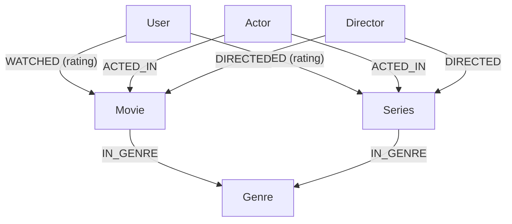

# DIO — Desafio Neo4j: Grafo de Conhecimento para Streaming

Este repositório apresenta a modelagem de um pequeno banco de dados em grafos para uma plataforma de streaming, desenvolvido como atividade prática da formação em Neo4j da **DIO**.

O objetivo foi representar usuários, filmes, séries, gêneros, atores e diretores como nós, conectando essas entidades por relacionamentos que permitem explorar o catálogo e as avaliações dos usuários.

## Modelo do grafo



## O que foi implementado

- **6 labels**: `User`, `Movie`, `Series`, `Genre`, `Actor` e `Director`.
- **6 constraints de unicidade**: uma para a propriedade `id` de cada label.
- **60 nós**: 10 registros de cada label, incluindo 10 filmes e 10 séries.
- **110 relacionamentos**: 30 `WATCHED`, 30 `ACTED_IN`, 20 `DIRECTED` e 30 `IN_GENRE`.
- A propriedade **`rating`** foi armazenada em `WATCHED`, pois a nota é atribuída por um usuário a uma produção específica.

Os dados são **fictícios**, criados exclusivamente para demonstrar a modelagem. O script utiliza `UNWIND` para carregar conjuntos de registros, `MERGE` para criar ou reutilizar nós/relacionamentos e `MATCH` para consultar o grafo.

## Resultado no Neo4j

A imagem abaixo registra a execução da consulta e a contagem exibida pelo Neo4j: **60 nós e 110 relacionamentos**.


A consulta de contagem por label confirma os **10 registros em cada uma das seis entidades**:


## Como executar

1. Abra um banco de estudos no Neo4j Browser ou no Neo4j Query.
2. Abra o arquivo [`desafio-neo4j-streaming.cypher`](desafio-neo4j-streaming.cypher).
3. Execute as instruções na ordem: primeiro as constraints, depois a criação dos nós, os relacionamentos e, por último, as consultas de validação. Se a interface não executar múltiplas instruções, selecione cada comando terminado em `;` individualmente.
4. Visualize o resultado com:

```cypher
MATCH p=()-[r]->()
RETURN p
LIMIT 150;
```

> **Observação:** execute de preferência em um banco de estudos separado. O script pode atualizar registros existentes que compartilhem os mesmos labels e IDs do exemplo.

## Arquivos

- [`desafio-neo4j-streaming.cypher`](desafio-neo4j-streaming.cypher): constraints, população dos dados, relacionamentos e consultas de validação.
- [`modelo-grafo-streaming.md`](modelo-grafo-streaming.md): documentação adicional do modelo e das cardinalidades.
- [`assets/grafo-neo4j.png`](assets/grafo-neo4j.png): captura de tela da execução no Neo4j.
- [`assets/contagem-nos.png`](assets/contagem-nos.png): confirmação dos 10 nós por label.
