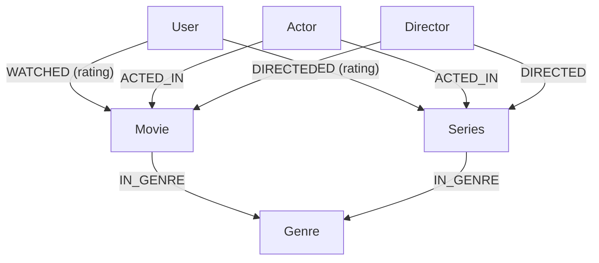

# Desafio DIO — Neo4j: modelo de grafo para streaming

## Objetivo

Modelar um catálogo fictício de streaming usando Neo4j e Cypher, contemplando
seis tipos de nós, quatro tipos de relacionamentos e a propriedade `rating` no
relacionamento `WATCHED`.

## Diagrama do modelo



## Nós e propriedades

| Label | Propriedades | Quantidade |
| --- | --- | ---: |
| `User` | `id`, `name`, `email` | 10 |
| `Movie` | `id`, `title`, `releaseYear` | 10 |
| `Series` | `id`, `title`, `seasons` | 10 |
| `Genre` | `id`, `name` | 10 |
| `Actor` | `id`, `name` | 10 |
| `Director` | `id`, `name` | 10 |

As seis constraints de unicidade garantem que não sejam criados dois nós com
o mesmo `id` dentro do mesmo label. Um `User` com `id = 1` e um `Movie` com
`id = 1` são permitidos porque pertencem a labels diferentes.

## Relações e cardinalidade no conjunto de exemplo

| Relacionamento | Origem → destino | Quantidade criada |
| --- | --- | ---: |
| `WATCHED {rating}` | `User` → `Movie` ou `Series` | 30 |
| `ACTED_IN` | `Actor` → `Movie` ou `Series` | 30 |
| `DIRECTED` | `Director` → `Movie` ou `Series` | 20 |
| `IN_GENRE` | `Movie` ou `Series` → `Genre` | 30 |

Total esperado: **60 nós e 110 relacionamentos**.

`rating` é uma propriedade da relação entre um usuário e uma produção, porque
usuários diferentes podem avaliar a mesma produção com notas distintas.

## Como executar

1. Abra um banco de estudos no Neo4j Browser ou Neo4j Query.
2. Abra `desafio-neo4j-streaming.cypher` e execute as instruções **na ordem**:
   primeiro as seis `CREATE CONSTRAINT`, depois os seis blocos `UNWIND ... MERGE`
   dos nós e, por último, o bloco de relacionamentos.
3. No editor, selecione uma instrução terminada em `;` por vez, caso a interface
   não ofereça execução de múltiplas instruções.
4. Execute as consultas de validação no final do arquivo. O resultado previsto
   é 10 nós de cada label e os quatro totais de relações acima.
5. Execute `MATCH p=()-[r]->() RETURN p LIMIT 150;` e use a visualização em grafo.

## Observações

- Os nomes e títulos são **fictícios** e foram feitos para exercitar a modelagem.
- Os `id` usados neste exemplo vão de 1 a 10 para cada label; execute-o de
  preferência em um banco separado. Se já houver nós com os mesmos labels/IDs,
  `MERGE` encontrará esses nós e `SET` atualizará suas propriedades.
- O script não remove nós nem relacionamentos.
- `MERGE` permite repetir a carga sem duplicar os padrões com os mesmos IDs e
  tipos de relacionamento, considerando que os dados existentes são consistentes.
- As constraints garantem unicidade dos IDs; não obrigam o preenchimento de
  outras propriedades e não restringem a faixa de notas de `rating`.

## Exemplos de consultas para apresentação

```cypher
// Quantidade de nós por label
MATCH (n)
UNWIND labels(n) AS label
RETURN label, count(*) AS quantidade ORDER BY label;
```

```cypher
// O que a usuária Ana Silva assistiu e como avaliou
MATCH (u:User {id: 1})-[w:WATCHED]->(obra)
RETURN u.name AS usuario, obra.title AS titulo, w.rating AS nota
ORDER BY nota DESC;
```

```cypher
// Atores e obras em que atuaram
MATCH (a:Actor)-[:ACTED_IN]->(obra)
RETURN a.name AS ator, obra.title AS titulo
ORDER BY ator, titulo;
```
